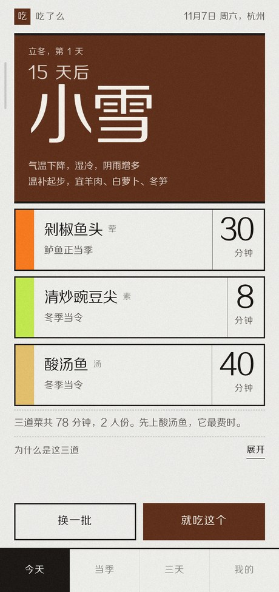
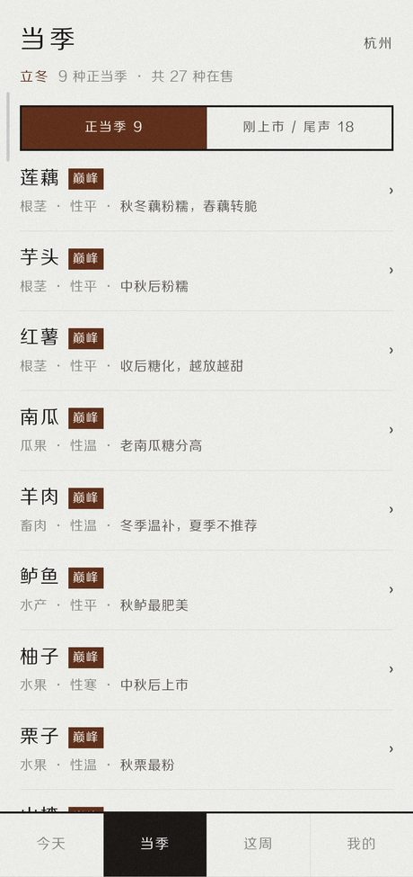
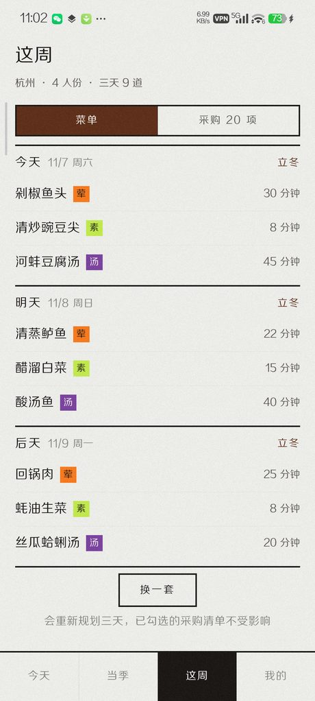

# 吃了么

> 按节气与地域，告诉你今天该吃什么。

一个完全离线的中式家常菜推荐应用。它不问你口味偏好问卷，只问你在哪个城市、平时做多久、几个人吃 ——
然后按当地当前的节气、物候和当季食材，给出今晚的三道菜。

本仓库只放**安装包与更新清单**，不含源码。

  
  
  

## 它解决什么

打开外卖软件要滑十分钟的人，其实不是不知道想吃什么，是**不知道现在这个时令该吃什么**。
立春该吃点辛甘发散的，霜降该润燥；东海边的小黄鱼和西北高原的羊肉不是一回事。
这些判断本来要靠家里的长辈，现在写进了一个 30 MB 的离线包里。

## 怎么用

1. 在 [Releases](../../releases/latest) 里下载最新的 `chileme-x.y.z.apk`
2. 允许「安装未知来源应用」后安装（应用不上架任何商店）
3. 首次打开选城市 → 直接给今天的三道菜

- **今天**：三道菜，各带做法与用时；点菜名进详情
- **当季**：当前物候区正当时的食材与做法
- **三天**：往后三天（今天 / 明天 / 后天）的菜单，合并成一张采购清单，勾选状态会保留
- **我的**：做菜偏好、收藏、最近做过、版本与更新检查

## 几个刻意的取舍

| 取舍 | 原因 |
|---|---|
| 只排三天，不排一周 | 买菜节奏本来就是两三天一趟；七天菜单一旦被一顿饭打乱（约饭、加班），剩下几天全成废弃计划 |
| 完全离线运行 | 除了检查更新，App 不发起任何网络请求 |
| 没有账号 | 不收集手机号、不收集位置精确定位（城市是你自己选的） |
| 记录不上传 | 换手机后记录不会跟着走 —— 用隐私换不到的东西，不如不要 |
| 不做社区、不做打卡 | 这是工具，不是内容平台 |

## 更新方式

App 每 6 小时最多检查一次更新（失败一律静默放行，不会因为断网卡在启动页）。
有新版本时，「我的」页底部会出现「有新版本 x.y.z ›」，点它跳转到本仓库的 Release 下载新版 APK。

清单地址固定：`releases/download/data/manifest.json`（常设 tag，永不失效）。

## 数据规模

| 项 | 数量 |
|---|---|
| 节气 | 24 |
| 物候区 | 7 |
| 城市 | 64 |
| 食材 | 139（含 36 种水果） |
| 当季性映射 | 274 条（七区 × 月份窗口） |
| 菜品 | 58（含食材用量、适用物候区） |

内容仍在补充。有菜谱错误、节气说法不对、或者你家乡的做法和 App 里不一样 —— 欢迎开 Issue 指出，
这类纠错会随数据包更新下发，不必等发版。

## 版本

最新版本与更新说明见 [Releases](../../releases)。
